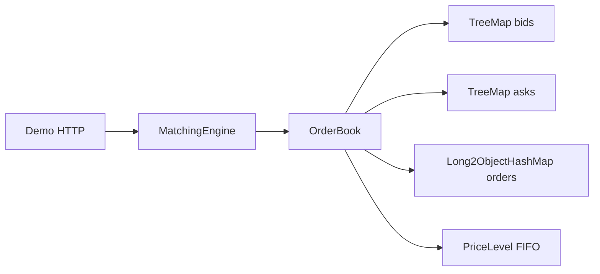
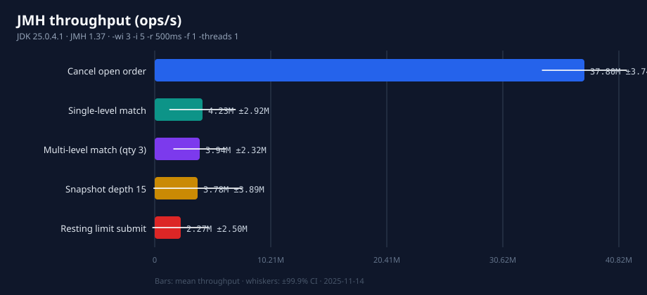
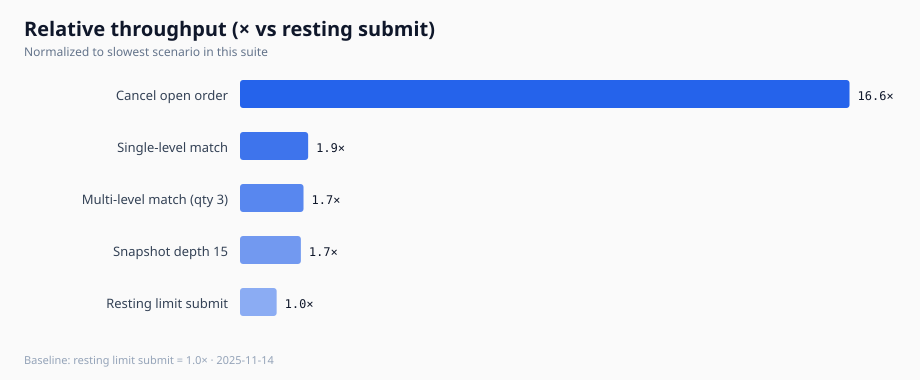

# HFT Order Book (Java 25)

In-memory **price–time** limit order book with a matching engine, HTTP demo UI, unit tests, and **JMH** benchmarks. Built as a learning and performance-baseline project toward low-latency exchange-style matching.

**Status:** `0.0.1-SNAPSHOT` — core matching works; not production-ready (see [FEATURES.md](FEATURES.md)).

## Highlights

- **Price–time priority:** best price first, FIFO at each `PriceLevel`
- **Maker price** on trades (resting order sets the trade price)
- **Book structure:** `TreeMap` price levels + intrusive FIFO queues + Agrona `Long2ObjectHashMap` for order lookup
- **Demo:** browser depth ladder, submit / cancel / replace, trade log
- **Benchmarks:** JMH throughput suite (`-Pjmh` Maven profile) — [charts below](#performance-jmh)

## Requirements

- **JDK 25** (enforced by Maven Enforcer)
- **Maven 3.9+** or `./mvnw`

## Quick start

### Tests

```bash
mvn test
```

### Demo server

```bash
mvn -q exec:java
```

Open [http://localhost:8765/](http://localhost:8765/) (port optional: `mvn -q exec:java -Dexec.args=8765`).

### JMH benchmarks

```bash
# Windows helper (builds target/benchmarks.jar and runs JMH)
benchmarks.bat

# Or manually
mvn -Pjmh package -DskipTests
java -jar target/benchmarks.jar -wi 5 -i 10 -r 1s -f 3 com.hft.orderbook.bench.OrderBookBenchmarks
```

Stable single benchmark:

```bash
java -jar target/benchmarks.jar -wi 5 -i 10 -r 1s -f 3 ".*restingSubmit"
```

## Project layout

```
src/main/java/com/hft/orderbook/
  book/          OrderBook, PriceLevel, snapshots
  matching/      MatchingEngine, Trade, MatchResult
  model/         Order, OrderSide, OrderStatus
  demo/          OrderBookDemoServer (JDK HttpServer)
src/jmh/java/    OrderBookBenchmarks
src/test/java/   JUnit 5 tests
src/main/resources/front/   Demo UI (HTML/CSS/JS)
```

## Demo API (HTTP)

| Method | Path | Description |
|--------|------|-------------|
| `GET` | `/api/book?depth=15` | Book snapshot (JSON) |
| `POST` | `/api/order` | Submit limit order `{ "side", "price", "quantity" }` |
| `POST` | `/api/cancel` | Cancel by `{ "orderId" }` |
| `POST` | `/api/replace` | Replace open order (new id, price, qty) |
| `GET` | `/api/order/status?id=` | Order lifecycle / lookup |
| `GET` | `/api/trades` | Recent trades |
| `POST` | `/api/seed` | Reset book with sample depth |

Static UI is served from `/` and `/front`.

## Architecture (current)



Matching loop: register taker → match against contra best level → remove filled makers → rest remainder on book.

## Feature checklist

See **[FEATURES.md](FEATURES.md)** for:

- ✅ Implemented capabilities  
- 🚧 In progress / planned  
- ❌ Out of scope for now  

## Performance (JMH)

Single-threaded throughput from a local run (JDK 25.0.4.1, JMH 1.37). Numbers vary by CPU and JVM — use them to track **this repo over time**, not as exchange SLA. Source: [docs/performance-baseline.json](docs/performance-baseline.json).

<p align="center">
  
</p>

<p align="center">
  
</p>

<p align="center">
  
</p>

| Benchmark | ~Throughput | Role |
|-----------|-------------|------|
| `cancelOpenOrder` | **37.8M** ops/s | Cancel resting order (micro-benchmark setup) |
| `singleLevelMatch` | **4.2M** ops/s | 1-lot match at one price |
| `multiLevelMatch` | **3.9M** ops/s | Small taker across levels |
| `snapshotDepth15` | **3.8M** ops/s | Depth-15 snapshot on seeded book |
| `restingSubmit` | **2.3M** ops/s | Limit add (book grows over trial) |

Regenerate charts after a new run:

```bash
mvn -Pjmh package -DskipTests
java -jar target/benchmarks.jar -wi 3 -i 5 -r 500ms -f 1 -rf json -rff target/jmh-results.json
# Update docs/performance-baseline.json, then:
powershell -File scripts/generate-performance-charts.ps1
```

## Dependencies

- [Agrona](https://github.com/real-logic/agrona) — `Long2ObjectHashMap`
- [Jackson](https://github.com/FasterXML/jackson) — demo JSON
- JUnit 5 — tests  
- JMH 1.37 — benchmarks (`-Pjmh` profile only)

## License

[MIT](LICENSE)

## Roadmap (summary)

1. Order types: IOC, FOK, market  
2. Single-threaded `engine` event loop  
3. Hot-path perf: cached best bid/ask, fewer allocations  
4. Optional: radix-tree price index (e.g. ART-style maps) instead of `TreeMap`  

Details in [FEATURES.md](FEATURES.md).